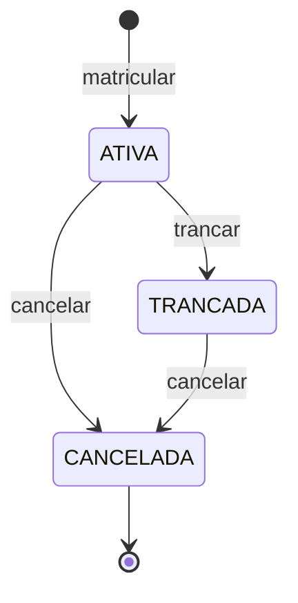
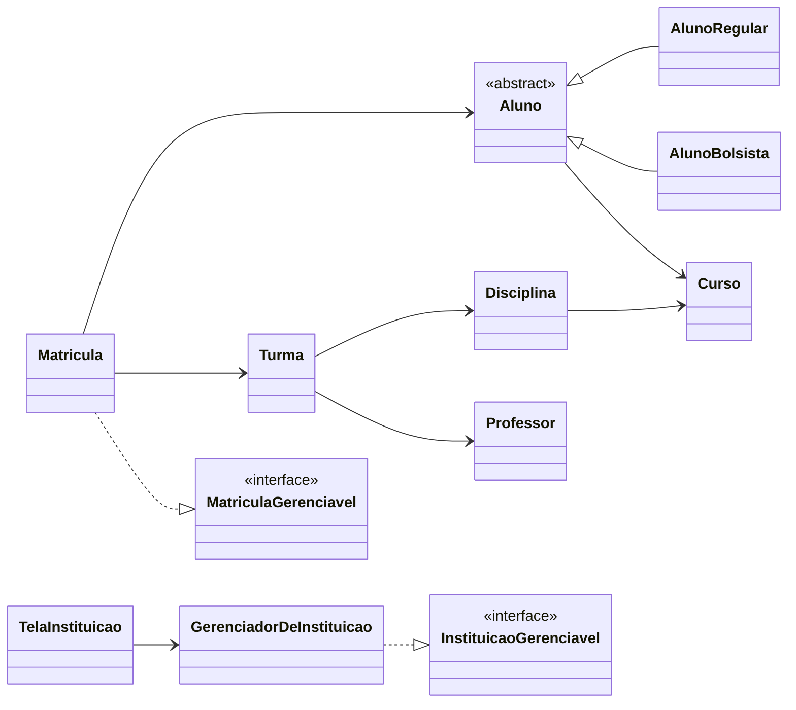

<div align="center">

# 🎓 Sistema de Gestão de Instituição de Ensino

**Trabalho final de Programação Orientada a Objetos**

Um sistema desktop que reúne em um só lugar o que a secretaria acadêmica controlava em planilhas soltas: cursos, disciplinas, professores, alunos, turmas, matrículas, notas, faltas e mensalidades.


</div>

---

## 📚 Contexto acadêmico

| | |
|---|---|
| 🏛️ **Instituição** | ULBRA (Universidade Luterana do Brasil) |
| 🎓 **Curso** | Engenharia de Software |
| 📘 **Disciplina** | Programação Orientada a Objetos |
| 👩‍🏫 **Professora** | Madianita Bogo Marioti |
| 💻 **Linguagem** | Java |
| 🗓️ **Período** | 2026/2 |
| 👥 **Formato** | Trabalho em dupla, com defesa em sala |

### O desafio

O enunciado não entregava as classes prontas. Ele trazia **relatos da secretaria, da coordenação e do financeiro** sobre como a instituição funciona, e a dupla precisava descobrir a partir deles:

- quais classes existem, com quais atributos e comportamentos;
- onde há herança e o que deve ser abstrato;
- quais relacionamentos são herança, associação, agregação ou composição;
- quais atributos não devem ter `set` e quais `get` são realmente necessários;
- em qual classe cada regra de validação deve ficar, para que nenhum objeto fique em estado inválido.

O trabalho foi entregue em duas etapas: os cadastros em **11/11** e o sistema completo, com defesa de 10 minutos, em **18/11**.

---

## ✨ Funcionalidades

A tela é um único `JFrame` com **sete abas**:

| Aba | O que faz |
|---|---|
| 🏫 **Cursos** | Cadastra cursos com código, nome e valor do crédito |
| 📖 **Disciplinas** | Cadastra disciplinas vinculadas a um curso, com quantidade de créditos |
| 👨‍🏫 **Professores** | Cadastra professores com titulação e e-mail |
| 🧑‍🎓 **Alunos** | Cadastra alunos **regulares** ou **bolsistas** (ProUni, institucional, atleta...) |
| 🗂️ **Turmas** | Abre turmas de uma disciplina, com professor, semestre e número de vagas |
| 📝 **Matrículas** | Matricula, busca, lança notas, registra faltas, tranca e cancela |
| 📊 **Relatórios** | Lista de frequência, vagas disponíveis, matrículas do aluno e mensalidade |

---

## 📏 Regras de negócio

<details>
<summary><b>💰 Mensalidade</b></summary>

<br>

```
valor bruto = soma dos créditos das matrículas ATIVAS × valor do crédito do curso do aluno
```

- O **aluno regular** paga o valor bruto.
- O **aluno bolsista** paga o valor bruto reduzido pelo percentual da bolsa.
- Matrículas trancadas ou canceladas não entram na soma.
- Disciplinas de outro curso entram normalmente, mas com o valor do crédito do curso **do aluno**.

> Exemplo: disciplinas de 4 e 2 créditos, crédito de R$ 120,00 → valor bruto de R$ 720,00.
> Regular paga R$ 720,00. Bolsista de 50% paga R$ 360,00.

</details>

<details>
<summary><b>📝 Notas, faltas e resultado</b></summary>

<br>

```
média = (nota1 + 2 × nota2) / 3
```

A média é calculada na hora, sem ser guardada. O resultado segue esta ordem:

| Condição | Resultado |
|---|---|
| Notas ainda não lançadas | `SEM NOTAS LANÇADAS` |
| Mais de 15 faltas | `REPROVADO POR FALTA` |
| Média menor que 6 | `REPROVADO POR NOTA` |
| Média 6 ou mais e até 15 faltas | `APROVADO` |

- As notas vão de 0 a 10 e podem ser lançadas de novo para correção.
- As faltas se somam às anteriores.
- Notas e faltas só mudam por esses métodos, nunca por alteração direta, e só em matrícula **ATIVA**.

</details>

<details>
<summary><b>🔄 Situação da matrícula</b></summary>

<br>



- Toda matrícula começa **ATIVA**, sem notas e com 0 faltas.
- O cancelamento é definitivo.
- Matrículas trancadas e canceladas continuam guardadas para consulta.
- A situação (ATIVA, TRANCADA, CANCELADA) é diferente do resultado acadêmico, e os dois aparecem separados nos relatórios.

</details>

<details>
<summary><b>🚫 O que o sistema recusa</b></summary>

<br>

- Código repetido em qualquer cadastro.
- Vínculo com curso, disciplina, professor, aluno ou turma inexistente.
- Turma sem vaga (contando só as matrículas ativas).
- Segunda matrícula do mesmo aluno na mesma turma, em qualquer situação.
- Nota fora do intervalo de 0 a 10.
- Operação incompatível com a situação da matrícula.

Toda operação responde com uma mensagem de sucesso ou com o motivo da recusa. Se for recusada, nada é alterado.

</details>

---

## 🏗️ Arquitetura



> O diagrama completo, com atributos, métodos, multiplicidades e justificativas, está em [`src/classDiagrama.mmd`](src/classDiagrama.mmd).

### Quem faz o quê

- **Classes do domínio** (`Curso`, `Disciplina`, `Professor`, `Aluno`, `Turma`, `Matricula`): guardam os dados e as regras que pertencem a elas. É a `Matricula`, por exemplo, que decide se aceita uma nota ou se pode ser trancada.
- **`GerenciadorDeInstituicao`**: é o ponto central. Guarda as listas, cria os objetos com `new`, recusa códigos repetidos, localiza os vínculos pelo código e monta os relatórios como texto.
- **`TelaInstituicao`**: só lê os campos, chama o gerenciador e mostra a mensagem recebida. Não tem listas, não cria objetos do domínio e não repete regras.

### 💡 Destaque: polimorfismo na mensalidade

O gerenciador **não precisa saber** se o aluno é regular ou bolsista. Ele calcula o valor bruto e entrega para o próprio aluno:

```java
return aluno.calcularMensalidade(valorBruto);
```

`Aluno` é abstrata e declara `calcularMensalidade` como método abstrato. Cada subclasse define a sua regra com `@Override`, e o Java escolhe a versão certa em tempo de execução.

---

## 🧠 Conceitos de POO aplicados

| Conceito | Onde aparece |
|---|---|
| **Encapsulamento** | Atributos `private`, sem nenhum `set`. Os dados só mudam pelos comportamentos da classe |
| **Herança** | `AlunoRegular` e `AlunoBolsista` herdam de `Aluno`, chamando `super(...)` |
| **Classe e método abstratos** | `Aluno` não pode ser instanciada, e `calcularMensalidade` é abstrato |
| **Polimorfismo** | Cálculo da mensalidade e `toString()` sobrescritos com `@Override` |
| **Interfaces** | `MatriculaGerenciavel` e `InstituicaoGerenciavel`, usadas com `implements` |
| **Associação** | Turma ↔ Disciplina, Turma ↔ Professor, Aluno ↔ Curso, Matrícula ↔ Aluno e Turma |
| **Sobrecarga de construtores** | Todas as classes do domínio têm construtor padrão e parametrizado |
| **Coleções** | `ArrayList` percorrido com `for-each` |

### Restrições do enunciado

O trabalho proibia o uso de lambda, `stream`, `var`, `Optional`, `record`, `enum` e coleções diferentes de `ArrayList`. Tudo foi feito com os recursos básicos da linguagem.

---

## 📁 Estrutura do projeto

```
pooFinal/
├── src/
│   ├── Curso.java
│   ├── Disciplina.java
│   ├── Professor.java
│   ├── Aluno.java                     # abstrata
│   ├── AlunoRegular.java
│   ├── AlunoBolsista.java
│   ├── Turma.java
│   ├── Matricula.java                 # implements MatriculaGerenciavel
│   ├── MatriculaGerenciavel.java      # interface fornecida
│   ├── InstituicaoGerenciavel.java    # interface fornecida
│   ├── GerenciadorDeInstituicao.java  # implements InstituicaoGerenciavel
│   ├── TelaInstituicao.java           # JFrame com as 7 abas
│   ├── TelaInstituicao.form           # layout do NetBeans
│   └── classDiagrama.mmd              # diagrama de classes (Mermaid)
├── nbproject/
└── build.xml
```

---

## ▶️ Como executar

**Pré-requisitos:** JDK 21 ou superior.

### Pelo NetBeans
1. *File → Open Project* e selecione a pasta `pooFinal`.
2. Pressione **F6** (*Run Project*).

### Pelo terminal
```bash
cd pooFinal
javac -encoding UTF-8 -d build/classes src/*.java
java -cp build/classes TelaInstituicao
```

### 🧪 Dados iniciais

Para facilitar os testes, o sistema já abre com alguns cadastros:

- **6 cursos** de TI, todos com crédito de R$ 120,00.
- **5 disciplinas** de 4 créditos.
- **5 professores**.
- **5 alunos**: 3 regulares e 2 bolsistas (Carla, ProUni 50%, e Diego, institucional 30%).
- **Turma 1** (Algoritmos, prof.ª Maria Silva, 30 vagas) com a aluna **Ana Costa** já matriculada.

> Os dados ficam só na memória. Ao fechar o programa, tudo volta ao estado inicial.

> Nos campos de nota, use **ponto** como separador decimal (`7.5`).

---

## 👥 Autores

| Nome | GitHub |
|---|---|
| Brunno Mota | [@bsmsoma](https://github.com/bsmsoma) |
| Charles Bruno | — |

<div align="center">

<br>

Feito para a disciplina de **Programação Orientada a Objetos** · **ULBRA** · 2026

</div>
